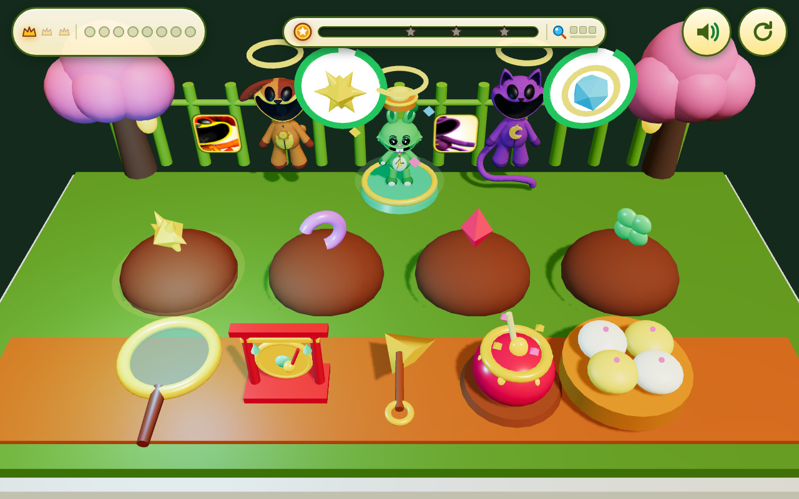

# 🔍⛏️🥟 Critter Treasure Scoop 3D: Magic Lens & Bun Swap!

🔗 **Play Live**: [https://kunruiw1991.github.io/critters-bunswap3d/](https://kunruiw1991.github.io/critters-bunswap3d/)

## ✨ Game Highlights
Inspired by hilarious web-novel treasure-interception & mind-reading tropes (*"隐藏信息读心镜 + 后山工兵铲挖宝 + 坑里留个热腾腾大包子"*):
- **🔍 1:1 3D Crystal X-Ray Magnifying Lens (`magic_lens`)**: Drag or tap the glowing cyan crystal magnifying glass over the Golden-Haloed Chosen One Critters to pop open their Mystery Clouds and reveal which of the 4 Emblem Dirt Mounds (`☀️ Star`, `🌙 Moon`, `💎 Ruby`, `🍀 Clover`) hides their buried treasure!
- **🔔 3D Lucky Garden Windbell & Temple Gong (`garden_gong`)**: Ring the vermilion-and-gold temple gong on the foreground deck to send a shimmering 3D golden soundwave ring across the garden, instantly revealing all waiting Explorers' hidden thought-bubbles, restoring `+3.5s` patience, and awarding `+10` bonus coins!
- **⛏️ 1:1 3D Golden Shovel Scoop (`golden_shovel`)**: Drag or tap the gleaming 3D Golden Shovel onto the target mound to launch a `1/120s` substepped shower of 3D dirt clods and pop out the **3D Golden Imperial Treasure Chest**!
- **🍯 3D Golden Honey & Sakura Berry Glaze Pot (`sauce_pot`)**: Tap the crimson-and-gold glaze pot (or sweep a steamed bun through it) to charge **3 Glazed Deluxe Buns** with spinning golden star swirls — or tap it while a mound is dug for a 1-tap auto-glaze + swap (`+12` deluxe glaze bonus coins and `+4.0s` patience boost)!
- **🥟 Steaming Bamboo Basket Bun Swap (`bun_steamer`)**: Swap a plump, bouncy **3D Steamed Bun** from the woven bamboo steamer into the open pit before the Chosen One arrives!
- **🐰 Friendly 3D Hoppy Hopscotch Helper Buddy & Surprise Rainbow Star-Bun Fever (`helper_buddy`)**: Hoppy Hopscotch cheers from a jade pedestal in the center garden, proactively assisting idle or low-patience Explorers every `6.5s` (or on tap for `+15` friendship coins), while every 4th served Explorer triggers **Golden Bun Party Fever** with a 3D rainbow starlight archway and falling sakura-star confetti!
- **🌟 Dynamic 8-Critter 3D Explorers & 3-Wave Courtyard Evolutions**: Dynamically swaps all 8 Critter 3D plush models (`DogDay`, `CatNap`, `Baba Chops`, `Hoppy Hopscotch`, `CraftyCorn`, `PickyPiggy`, `Bubba Bubbaphant`, `KickinChicken`) across **Wave 1 (`Sunny Blossom Courtyard`)**, **Wave 2 (`Twilight Lantern & Lotus Festival` with 6 Golden Lotus Lanterns & Double-Decker Jade Steamer)**, and **Wave 3 (`Imperial Starlight Sanctuary` with Royal Moon-Gate Torii Archway & Floating Starlight Crystals)**.
- **🔇 100% Zero-Text & Zero-Voiceover Pure Visual UI**: Built for 5-year-old players with zero words or numbers (`alphaHanziCount === 0`), custom procedural WebAudio kalimba/marimba & temple gong synthesis, `>= 80px` touch targets, and a 5-Critter Top-3 Podium progression system.
